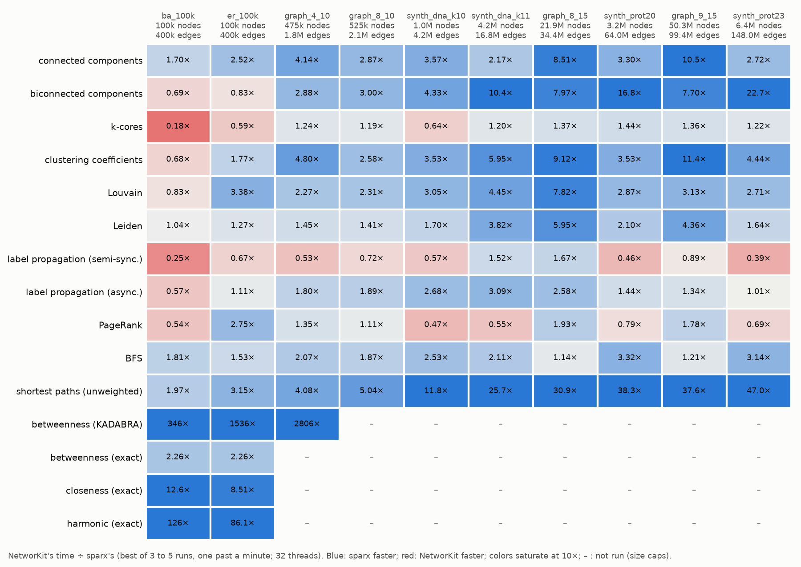
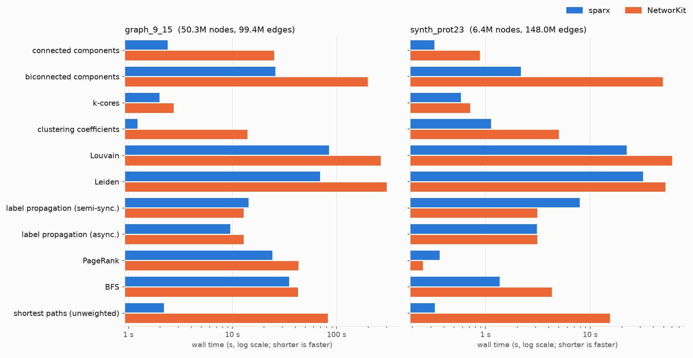
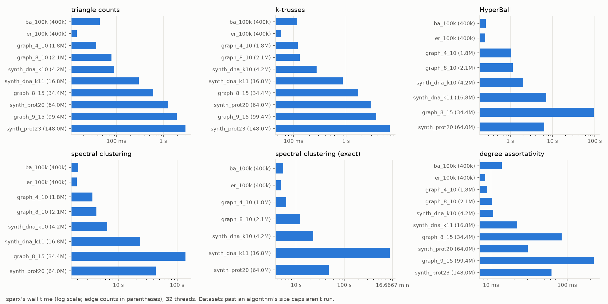

# SparX

> **Biconnected components (articulation points and bridges) of a 148M-edge graph in 2.2 seconds, where NetworKit takes 49: 23× faster**, with the same exact result.
> On the same graph: k-truss in 6.7 s, Louvain in 22 s, unweighted shortest paths 45× faster than NetworKit. See [Benchmarks](#benchmarks-against-networkit).

High-performance **Rust** library for large-scale **static sparse graphs analytics** on commodity hardware. Built on a memory-mapped core. It includes implementations of:

- **k-core decomposition** (Batagelj–Zaversnik sequential; Liu et al. parallel)
- **k-truss decomposition** (Burkhardt et al. sequential; PKT parallel)
- **Louvain and Leiden** (GVE-Louvain and GVE-Leiden variants, undirected and directed, communities always connected)
- **Label propagation** (semi-synchronous, deterministic whatever the threads; and asynchronous)
- **Spectral clustering** (exact and compressive)
- **Betweenness centrality** (exact, Brandes; approximate, KADABRA)
- **HyperBall** (HyperLogLog distance/centrality estimation) and **exact closeness/harmonic centralities**
- **PageRank** (partition-centric for graphs whose ranks don't fit in cache, pulling otherwise)
- **Heat Kernel PageRank** (HK-relax --- SSPR/MSPR)
- **Shortest paths** (hybrid parallel BFS; Dijkstra and Δ-stepping on weighted graphs; A* with landmarks)
- **Components** (connected, strongly connected, biconnected: articulation points and bridges) and **degree assortativity**
- Classic traversals/utilities (BFS/DFS, Hierholzer’s Euler trails, clustering coefficient, transitivity, triangle counting, etc.)

Most algorithms run on directed graphs as well, and the library has **Python bindings** (`python/`).
Comes with CSV **benchmark writers** and **plotting scripts** to visualize runtime scaling versus graph size.

---

## Table of contents

- [Features](#features)
- [Pre-requisites](#pre-requisites)
- [Installation](#installation)
- [Data formats](#data-formats)
- [Quick start](#quick-start)
  - [Manually Linking *SparX*](#manually-linking-sparx)
  - [Load & inspect](#loading--inspecting-a-graph)
  - [Run algorithms](#running-algorithms)
  - [Examples](#examples)
  - [Narrow index types & accumulators](#narrow-index-types--accumulators)
  - [Configurable edge/community weight precision](#configurable-edgecommunity-weight-precision)
  - [Weighted graphs](#weighted-graphs)
  - [Triangle counts, trussness widths & directed triangles](#triangle-counts-trussness-widths--directed-triangles)
  - [Coreness widths](#coreness-widths)
  - [GPU HyperBall & triangles](#gpu-hyperball--triangles)
  - [SIMD](#simd)
  - [Directed graphs](#directed-graphs)
  - [Biconnectivity](#biconnectivity)
  - [Assortativity](#assortativity)
  - [Louvain & Leiden](#louvain--leiden)
  - [Spectral clustering](#spectral-clustering)
  - [Label propagation](#label-propagation)
  - [Betweenness centrality](#betweenness-centrality)
- [Benchmarks against NetworKit](#benchmarks-against-networkit)
- [Python](#python)
- [Testing](#testing)
- [Reproducibility](#reproducibility)
  - [Scripts](#scripts)
  - [Memory Benchmarks](#memory-benchmarks)
  - [Wall-Time Benchmarks](#wall-time-benchmarks)

---

## Features

- Zero-copy, **memory-mapped** graph store: `GraphMemoryMap<N, E, Ix>`
- Pluggable index types (`usize`/`u32`/`u16`/`u8`) and optional node/edge labels
- **Narrow-`Ix` throughout**: every algorithm's internal scratch arrays (not just the graph's own
  CSR storage) use the graph's chosen `Ix` width, so picking e.g. `u32` on a sub-4-billion-edge
  graph reduces memory traffic for every traversal, decomposition, and centrality in the crate,
  not just storage size
- **Configurable accumulator width** during parsing (`AccumulatorAtomic`: `AtomicUsize`/`AtomicU32`/
  `AtomicU16`/`AtomicU8`), independent of the final `Ix` --- lets the (hot, streamed-through-once)
  degree/edge-position accumulation itself run narrower, not just the resulting CSR
- Cache-entry **`Ix` conversion**: re-encode an existing cache at a different index width without
  re-parsing the original dataset
- **Configurable edge/community weight precision** (`Weight`: `f32`/`f64`) for GVE-Louvain,
  HyperBall, and the exact centralities, independent of `Ix`
- **Weighted graphs**: edge weights of any integer or float type (`Weighted<T>`), read fast or
  validated, used by PageRank, Louvain/Leiden, clustering, assortativity, HK-Relax and HKPR
- Cache files + rich **metadata** (`Display` implemented)
- Algorithms expose summaries and can **drop** local caches
- Minimal, dependency-free **CSV appenders** to `results/`
- Ready-to-use **plotting** scripts (with Matplotlib) for reproducibility

---

## Pre-requisites

- **Rust ≥ 1.95**

If you don’t already have Rust installed or need to update to at least version 1.95, the recommended way is via [rustup](https://rustup.rs):

```bash
curl --proto '=https' --tlsv1.2 -sSf https://sh.rustup.rs | sh
```

After installing Rust, restart your shell and verify:

```bash
rustc --version
```

If the installation was successful, a version number ≥ 1.95 should be printed.

## Installation

To use *SparX* in a project, add it from crates.io (see [Linking *SparX*](#linking-sparx)):

```bash
cargo add sparx-graph --rename sparx
```

To run the examples, tests and benchmarks, or to use the [OOTB Datasets](#ootb-datasets), clone the library's GitHub repository (if you want to use the [OOTB Datasets](#ootb-datasets) made available via `scripts/datasets/build_datasets.sh` it is advisable you clone `sparx` to the same directory you have cloned `GGCAT` into if you have previously done so):

```bash
git clone git@github.com:alexfaisca/sparx.git
```

In macOS, in the first installation, after cloning the repository, Apple's tool licensing must be accepted. You may do so by running:

```bash
sudo xcodebuild -license
```

After this, you may change directory into the repository and build the library (recommended in release mode):

```bash
cd sparx
cargo build --release
```

The library has an assortment of non-default features. As an example, `feature = "rayon"` may be enabled by running the following command:

```bash
cargo build --features rayon --release
```

## Data Formats

Input: **GGCAT Output Files** (`.lz4`), **Matrix Market** (`.mtx`), **nodes/edges** files and cached internal formats (auto-created on first load).

Matrix Market files must be sparse (`coordinate`) square matrices, with `pattern`, `integer`, `real`
(or `double`) or `complex` entries, `general` (one arc per entry) or `symmetric`, `skew-symmetric`
or `hermitian` (each entry an arc both ways, so an undirected graph). Entries' values are kept as
edge labels when the graph is loaded with integer labels (which `real`, `complex` and
`skew-symmetric` files' values can't be), and ignored otherwise. The number of entries must match
the size line's.

Nodes/edges input (feature `nodes_edges`, on by default) is a pair of files: `unitig_annotated_<name>.nodes`,
one node per line (its id first), and `unitig_<name>.edges`, one edge per line (`<src> <dst> <DIR>`,
`DIR` one of `FF`/`FR`/`RF`/`RR`, in any case). It carries no weights.

### OOTB Datasets

A script to build datasets out-of-the-box is provided for reproducibility and sandboxing purposes: `scripts/datasets/build_datasets.sh`. It builds all the datasets used for testing and benchmarking the library. It may be run in the following manner:

```bash
bash scripts/datasets/build_datasets.sh
```

It is possible to benchmark the library with datasets outside of those built with `scripts/datasets/build_datasets.sh`, to guarantee all benching related tools', e.g. plotting scripts, preconditions entry consisting of `<dataset_name>,<V>,<E>` should be added to `datasets_size.csv` (`<dataset_name>` should be the dataset's filename without file extension):

```csv
dataset,V,E
kmer_V1r,222222,3333333
kmer_V2a,55042369,117217600
...
my_custom_dataset,123123,123123123
```

## Quick Start

To follow this guide it is advisable you first run the `scripts/datasets/build_datasets.sh` script. This way you will be able to follow along and use the provided code examples as they come.

## Manually Linking *SparX*

*SparX* is published on crates.io as `sparx-graph` (its library is named `sparx`); it can also be linked from Git or from a local clone.

### Creating a Rust Project

To create a Rust project run:

```bash
cargo new myapp
cd myapp
```

This creates a folder `myapp/` with the usual Rust project layout.

```arduino
parentdir/
  myapp/           # new crate
    src/           # source code
    Cargo.toml     # cargo configuration
```

### Linking *SparX*

#### 1. From crates.io.

  The crate is named `sparx-graph` (`sparx` is taken on crates.io), but its library is `sparx`, so code
  always uses `use sparx::...`. Add it to the `[dependencies]` section in `myapp/Cargo.toml`:

```toml
[dependencies]
sparx = { package = "sparx-graph", version = "0.2" }
# optionally, select features: input formats (`mtx`, `ggcat`, `nodes_edges`, all on by default),
# `rayon`, `petgraph` and `rustworkx` (exports to their graphs)
# sparx = { package = "sparx-graph", version = "0.2", features = ["rayon"] }
```

  or run `cargo add sparx-graph --rename sparx`.

#### 2. From Git.

  For unreleased changes, depend on the repository, at a commit or tag:

```toml
[dependencies]
sparx = { package = "sparx-graph", git = "https://github.com/alexfaisca/sparx.git", tag = "v0.2.1" }
```

#### 3. Installing and linking *SparX* directly inside a Rust project.

  Install *SparX* as shown in [Installation](#installation) directly inside `myapp/`, after which, your project layout will look something like:

```arduino
parentdir/
  myapp/           # new crate
    sparx/         # sparx library
    src/           # source code
    Cargo.toml     # cargo configuration
```

  Define *SparX* as a member of your workspace and add it to your project's dependencies in `myapp/Cargo.toml`:

```toml
[workspace]
  members = [".", "sparx"]

[dependencies]
  sparx = { package = "sparx-graph", path = "./sparx" }
  # optionally, select features to be enabled:
  # sparx = { package = "sparx-graph", path = "./sparx", features = ["mtx","ggcat","rayon"] }
```


#### 4. Installing and linking *SparX* in a workspace.

  If your library already has a top-level `Cargo.toml` with a `[workspace]`, in similar layout to the one shown bellow:

 ```arduino
workspace/
  myapp/           # new crate
    src/           # source code
    Cargo.toml     # cargo configuration
  Cargo.toml       # workspace file
 ```

  Install *SparX* as shown in [Installation](#installation) next to `myapp/`, after which, your project layout will look something like:

 ```arduino
workspace/
  myapp/           # new crate
    src/           # source code
    Cargo.toml     # cargo configuration
  sparx/           # sparx library
  Cargo.toml       # workspace file
 ```

  Add *SparX* to the members of the workspace in `workspace/Cargo.toml`:

```toml
[workspace]
  members = ["myapp", "sparx"]
```

  And then, add it to your project's dependencies in `myapp/Cargo.toml`:

```toml
[dependencies]
  sparx = { package = "sparx-graph", path = "../sparx" }
  # optionally, select features to be enabled:
  # sparx = { package = "sparx-graph", path = "../sparx", features = ["mtx","ggcat","rayon"] }
```

## Loading & Inspecting a Graph

```rust no_run
use sparx::graph::Graph;

fn main() -> Result<(), Box<dyn std::error::Error>> {
    // path to the dataset from which a graph is to be built
    let path = "./datasets/graphs/kmer_V2a.mtx";
    // build the graph --- graph is mutable so calling drop_cache() becomes possible
    let mut g = Graph::<(), (), usize>::from_file(path, None, Some(32))?;
    println!("graph built (|V|={:?}, |E|={})", g.size(), g.width());
    println!("metadata:\n{}", g.metadata()?);
    // drop graph's cache entry
    g.drop_cache()?;
    Ok(())
}

```

### Custom labels

Nodes and edges may carry labels (GGCAT links' orientations, k-mers' colors...), stored in
memory-mapped files of their own: `sparx::label!` declares label types, integer newtypes with all
the traits graphs need.

```rust no_run
use sparx::graph::Graph;

sparx::label! {
    /// A k-mer's color.
    pub struct Color(u32): N;
    /// A link's orientation.
    pub struct Orientation(u8): E;
}

fn main() -> Result<(), Box<dyn std::error::Error>> {
    let g = Graph::<Color, Orientation, u32>::from_file("graph.lz4", None, None)?;
    println!("{:?}", g.weighted_neighbours(0)?.collect::<Vec<_>>());
    Ok(())
}
```

## Running Algorithms

Every algorithm is a struct built from a graph: it runs when built, exposes its results, and keeps
them in memory-mapped files of the graph's cache until `drop_cache` removes them (as
`g.drop_cache()` does the graph's own). Each section below covers one family; `examples/` has a
runnable program for each.

```rust no_run
use sparx::centralities::hyper_ball::HyperBall6;
use sparx::communities::gve_louvain::AlgoGVELouvain;
use sparx::graph::Graph;
use sparx::k_core::liu_et_al::AlgoLiuEtAl;
use sparx::k_truss::pkt::AlgoPKT;

fn main() -> Result<(), Box<dyn std::error::Error>> {
    let mut g = Graph::<(), (), u32>::from_file("./datasets/graphs/kmer_V2a.mtx", None, Some(32))?;

    // every node's coreness (parallel, Liu et al.)
    let mut cores = AlgoLiuEtAl::new(&g)?;
    println!("coreness of node 0: {}", cores.coreness(0));
    cores.drop_cache()?;

    // every edge's trussness (parallel, PKT), in CSR order
    let mut trusses = AlgoPKT::new(&g)?;
    println!("max trussness: {:?}", trusses.k_trusses().iter().max());
    trusses.drop_cache()?;

    // communities (GVE-Louvain), with `f64` weights
    let mut louvain = AlgoGVELouvain::<_, _, _, f64>::new(&g)?;
    println!(
        "{} communities, modularity {:.4}",
        louvain.community_count(),
        louvain.partition_modularity()
    );
    louvain.drop_cache()?;

    // closeness centrality estimates (HyperBall, 2^6 registers per counter)
    let mut hyperball = HyperBall6::new(&g)?;
    let closeness = hyperball.get_or_compute_closeness_centrality(true)?;
    println!("closeness of node 0: {:.4}", closeness[0]);
    hyperball.drop_cache()?;

    g.drop_cache()?;
    Ok(())
}
```

## Examples

`examples/` has a runnable program per algorithm family. Each one runs on a small bundled graph by
default, or on the graph you pass it:

```bash
cargo run --release --example k_core          # k-cores, sequential and parallel
cargo run --release --example k_truss         # triangles, k-trusses, clustering coefficients
cargo run --release --example communities     # Louvain, Leiden, label propagation, spectral, HK-Relax
cargo run --release --example centralities    # HyperBall vs exact closeness, PageRank, betweenness
cargo run --release --example components      # connected, biconnected, strong components; assortativity
cargo run --release --example shortest_paths  # weighted Dijkstra/Δ-stepping, shortest paths, A*
cargo run --release --example traversals      # BFS distances and Euler trails
cargo run --release --example k_core -- ./datasets/graphs/kmer_V2a.mtx 16   # your own graph, 16 threads
```

They all take `[graph] [threads]` (and some a node, last), default to 4 threads, and drop every
cache entry they made, also when a run fails. `hyperball_timing` (with `--features bench`) is a
profiling tool rather than an example.

## Narrow Index Types & Accumulators

`GraphMemoryMap<N, E, Ix>`'s `Ix` type parameter (`usize`, `u32`, `u16`, or `u8`) controls the
width of *every* node/edge index stored throughout the crate --- not just the graph's own CSR
offsets/neighbours arrays, but every algorithm's internal scratch buffers too (community
assignments, coreness/trussness bookkeeping, traversal stacks/queues, Euler trail indices, etc.).
Choosing a narrower `Ix` that still comfortably fits the graph's node/edge counts reduces memory
traffic everywhere those buffers are streamed through.

```rust no_run
use sparx::graph::{AtomicU32, GraphMemoryMap};

fn main() -> Result<(), Box<dyn std::error::Error>> {
    let path = "./datasets/graphs/kmer_V2a.mtx";

    // build directly with a narrower Ix (valid as long as the graph's node/edge counts fit
    // u32::MAX --- this is checked, and parsing fails loudly otherwise)
    let g: GraphMemoryMap<(), (), u32> = GraphMemoryMap::from_file(path, None, Some(32))?;

    // the width-matched accumulator used for the (hot, streamed-once) degree/edge-position
    // accumulation during parsing is independent of Ix, and defaults to AtomicUsize for safety
    // --- opt into a narrower one explicitly once you know it fits, for reduced memory traffic
    // during parsing itself:
    let g_fast: GraphMemoryMap<(), (), u32> =
        GraphMemoryMap::from_file_with_accumulator::<_, AtomicU32>(path, None, Some(32))?;

    // convert an already-built cache (any Ix) to a narrower one without re-parsing the original
    // dataset --- yields a new, independent cache entry; fails loudly (rather than silently
    // truncating) if the graph's node/edge counts don't actually fit the target width
    let g_default: GraphMemoryMap<(), (), usize> = GraphMemoryMap::from_file(path, None, Some(32))?;
    let g_u32: GraphMemoryMap<(), (), u32> = g_default.convert_index_type::<u32>()?;

    println!("{} {} {}", g.size(), g_fast.size(), g_u32.size());
    Ok(())
}

```

## Configurable Edge/Community Weight Precision

GVE-Louvain, HyperBall, and the exact centralities (`ExactClosenessCentrality`,
`ExactHarmonicCentrality`, `ExactLinCentrality`) take an additional `W: Weight` type parameter
(`f32` or `f64`, defaulting to `f64`), independent of `Ix`, controlling the precision of their
stored edge/community weights and accumulated distances. Narrower `f32` storage reduces memory
traffic on large graphs; numerically sensitive comparisons (e.g. GVE-Louvain's modularity-gain
decision) are always computed in `f64` internally regardless of `W`, so narrowing `W` doesn't
sacrifice correctness.

```rust no_run
use sparx::communities::gve_louvain::AlgoGVELouvain;
use sparx::graph::Graph;

fn main() -> Result<(), Box<dyn std::error::Error>> {
    let path = "./datasets/graphs/kmer_V2a.mtx";
    let g = Graph::<(), (), usize>::from_file(path, None, Some(32))?;

    // f64 weights (default) --- turbofish needed here since Rust doesn't infer defaulted
    // generic parameters from a bare `::new(...)` call
    let louvain_f64 = AlgoGVELouvain::<_, _, _, f64>::new(&g)?;

    // f32 weights --- halves the memory traffic of the k/sigma/edge-weight accumulators
    let louvain_f32 = AlgoGVELouvain::<_, _, _, f32>::new(&g)?;

    println!(
        "{} {}",
        louvain_f64.partition_modularity(),
        louvain_f32.partition_modularity()
    );
    Ok(())
}

```

## Weighted Graphs

An edge label type's `E::is_weighted()` makes its graph weighted: `Weighted<T>` holds a weight of
any of `u8`..`u64`, `usize`, `i8`..`i64`, `isize`, `f32` or `f64`, read from a MatrixMarket file's
values (`pattern` files' edges weigh one; GGCAT and nodes/edges files carry no weights, and
refuse weighted labels). A weight's stored type is independent of the `W: Weight` algorithms
compute with: they read `E::weight::<W>()`. Unweighted labels weigh one --- even labeled ones,
like GGCAT edges' directions --- and algorithms don't read their label file at all.

Weights are parsed `WeightParsing::Fast` by default: no per-value validation, a value that isn't
one of the type (`70000` as a `u16`, `-3` as a `u32`, `abc`) giving an unspecified weight.
`WeightParsing::Checked` (through `from_file_with_weight_parsing`) refuses them instead. Either way,
what a file declares is checked once against the type: a `real` file can't load integer weights,
nor a `skew-symmetric` one unsigned weights. A cache entry only opens with its own weight type.

```rust no_run
use sparx::graph::{DiGraph, Graph, WeightParsing, Weighted, label::VoidLabel};

fn main() -> Result<(), Box<dyn std::error::Error>> {
    // u32 weights, unvalidated
    let g = Graph::<VoidLabel, Weighted<u32>, usize>::from_file("graph.mtx", None, None)?;
    // f64 weights, every value validated
    let d = DiGraph::<VoidLabel, Weighted<f64>, usize>::from_file_with_weight_parsing(
        "digraph.mtx", None, None, WeightParsing::Checked,
    )?;
    println!("{} {}", g.total_weight()?, d.weighted_degree(0)?);
    Ok(())
}
```

Algorithms using weights follow networkx's `weight="weight"`; weights must be finite and
non-negative:

| Algorithm | Weighted as |
|---|---|
| `PageRank` | transitions in proportion to weight; nodes whose arcs all weigh nothing dangle (always partition-centric: pulling reads in-arcs' weights off out-arcs) |
| `AlgoGVELouvain` (and Leiden), `Graph::modularity` | weighted modularity |
| `DirectedLouvain`, `directed_modularity` | weighted directed modularity, still exact: weights must be integers (`3.0` is one), totalling at most `2^60` |
| `ClusteringCoefficient`, `DirectedClusteringCoefficient` | Onnela's and Fagiolo's weighted local coefficients (transitivity stays unweighted, as networkx's) |
| `degree_assortativity`, `directed_degree_assortativity` | correlation of strengths (weighted degrees), Pearson's or Spearman's |
| `HKRelax`, `ApproxDirHKPR`, `sweep_cut` | weighted diffusion, walks and conductance (`Community::volume` is the weighted volume, `width` the arc count); sweeps break ties in diffusion by node, and `ApproxDirHKPR`'s walks are seeded (`with_random_seed`), so communities repeat exactly |
| `LabelPropagation` | labels weigh their arcs' weights |
| `SpectralClustering`, `SpectralEmbedding` | the weighted adjacency's regularized Laplacian (the Bethe Hessian is unweighted only) |
| `ExactClosenessCentrality`, `ExactHarmonicCentrality`, `ExactLinCentrality` | weighted distances (networkx's `distance="weight"`), by Dijkstra's algorithm from every node; nodes at distance zero count as reached but add nothing to harmonic sums |
| `DijkstraDists` (`trails::dijkstra`) | single-source weighted distances (`f64::INFINITY` where unreachable), `BFSDists`' weighted counterpart: Dijkstra's algorithm, or Δ-stepping on many threads (see below) |
| `astar`, `astar_many`, `Landmarks` (`trails::astar`) | point-to-point shortest paths (see below) |

Unweighted graphs keep the batched multi-source BFSs: the choice is made at compile time, from
the edge label type. `BFSDists` and the other traversals, HyperBall (whose counters count hops),
k-cores, k-trusses, triangles and components ignore weights.

Two gaps are left on purpose. GGCAT and nodes/edges inputs carry no edge weights (GGCAT's
abundances are unitigs', not edges'; the nodes/edges text format, BCALM's, has none), so they
refuse weighted labels: weighted graphs come from MatrixMarket files. And `degree_assortativity_gpu`
on weighted graphs sums on the CPU: the GPU variants are exact, summing integer products, which
strengths (floats) aren't, and WGSL has no portable `f64`.

### Shortest Paths & A*

`DijkstraDists` picks its `ShortestPathEngine`: `Sequential` (Dijkstra's algorithm with an
indexed 4-ary heap, at most `|V|` entries) or `DeltaStepping` (Meyer and Sanders, as GAP
implements it, with GraphIt's bucket fusion): buckets of distances `Δ` wide (by default, the mean
weight), emptied by every thread at once with atomic minima, no shared queue. Both find the same
distances, bit for bit. `Auto` (the default) runs Δ-stepping from 2^16 nodes on more than one
thread: on 32 threads, about 10 times as fast as Dijkstra's algorithm on random graphs, and 5
times on road-like grids (whose narrow fronts leave threads less to share). It synchronizes
threads at every bucket, so on a busy machine, fewer threads than cores may well be faster.

Paths are optional: `DijkstraDists` keeps only distances until `predecessors()` (or
`path_to(v)`) is first called, which then finds a shortest path tree in one more parallel pass
(`size_of::<Ix>()` bytes per node): each node's parent is the least of its in-neighbours on
shortest paths with the fewest arcs from the source, so the tree is the same whatever the engine
and threads, and acyclic even through zero-weight cycles.

`astar(g, source, target, &heuristic)` finds a shortest path (its length, nodes, and the nodes
it expanded), and `astar_many(g, &queries, &heuristic)` many, in parallel, a whole query per
thread. A query's memory grows with the nodes it explores, not with the graph. Any
`Fn(v, target) -> f64` lower bound is a `Heuristic` (inconsistent ones too: nodes are expanded
again where needed); without coordinates, `Landmarks::new(&g, k)` (ALT, Goldberg and
Harrelson) picks `k` landmarks farthest first and keeps their distances from (and, on directed
graphs, to) every node as `f32`s (`4k|V|` bytes, twice that directed), bounding distances by
the triangle inequality. They're kept in the graph's cache: `Landmarks::open(&g)` maps them back,
from any instance of the graph (another process's included), without finding them again.

`astar_with` and `astar_many_with` take `AStarOptions`: `paths: false` finds distances only (8
bytes less per node explored), and `bidirectional: true` searches from both ends at once. With a
consistent heuristic (`Heuristic::consistent`, as `NoHeuristic`'s), bidirectional search shares
an averaged potential between its directions and stops as soon as their frontiers' keys add up to
the best path; otherwise it uses the symmetric stopping rule, correct for any admissible
heuristic but slower. `Landmarks` are consistent only up to their `f32` rounding, so they use it.
Expanded nodes per query (1M-node graphs):

| | Dijkstra | bidirectional Dijkstra | A*, 8 landmarks |
|---|---|---|---|
| grid (long paths) | 531k | 365k | **35k** |
| random, 8M arcs (short paths) | 547k | **2.8k** | 136k |

`DijkstraVisit` and `astar_visit` run the searches with a `ShortestPathVisitor` (in
`trails::shortest_path_visit`), as `BFSVisit` and `DFSVisit` do traversals: hooks
`discover_vertex`, `examine_vertex`, `examine_edge`, `edge_relaxed`, `edge_not_relaxed` and
`finish_vertex` (Boost's), any of which can stop the search by returning `ControlFlow::Break`.
Hooks are called through generics: those a visitor doesn't override cost nothing, and the
searches without a visitor run the same code, with a no-op one.

```rust no_run
use sparx::graph::{DiGraph, Weighted, label::VoidLabel};
use sparx::trails::astar::{AStarOptions, Landmarks, NoHeuristic, astar, astar_many_with};
use sparx::trails::dijkstra::DijkstraDists;
use sparx::trails::shortest_path_visit::{DijkstraVisit, ShortestPathVisitor};
use std::ops::ControlFlow;

/// Stops once a node farther than `radius` is reached.
struct Within(f64);
impl ShortestPathVisitor for Within {
    fn examine_vertex(&mut self, _u: usize, d: f64) -> ControlFlow<()> {
        if d > self.0 { ControlFlow::Break(()) } else { ControlFlow::Continue(()) }
    }
}

fn main() -> Result<(), Box<dyn std::error::Error>> {
    let g = DiGraph::<VoidLabel, Weighted<f64>, u32>::from_file("roads.mtx", None, None)?;
    // landmarks found once, then reopened from the cache
    let landmarks = Landmarks::open(&g).or_else(|_| Landmarks::new(&g, 8))?;
    if let Some(path) = astar(&g, 0, 4_000_000, &landmarks)? {
        println!("{} long, {} nodes", path.distance, path.nodes.len());
    }
    // distances only, bidirectional Dijkstra
    let options = AStarOptions { bidirectional: true, paths: false };
    let paths = astar_many_with(&g, &[(1, 2), (3, 4)], &NoHeuristic, options)?;
    println!("{:?}", paths.iter().flatten().map(|p| p.distance).collect::<Vec<_>>());
    // every distance from node 0, and a path, its tree found only now
    let mut d = DijkstraDists::new(&g, 0)?;
    println!("{:?}", d.path_to(42)?);
    // the nodes within 1000 of node 0
    let ball = DijkstraVisit::new(&g, 0, &mut Within(1000.))?;
    println!("{}", ball.get_distances().iter().filter(|x| **x <= 1000.).count());
    Ok(())
}
```

`DiGraph::to_undirected_merging(mode, WeightMerge)` weighs an undirected edge merged from several
arcs (`Collapse` and `Mutual`: every arc between two nodes, both ways) by their `Sum` (the
default, as `to_undirected`'s; integer sums overflowing their type fail), `Min` or `Max`: the
same weight from both ends.

## Triangle Counts, Trussness Widths & Directed Triangles

Per-edge triangle counts and trussness values are `Tx` integers (`u8`, `u16`, `u32` or `u64`), like
the graph's `Ix`: `u8` (the default, used by `new`, `get_or_compute`, ...) keeps them small for
large sparse graphs, while wider ones handle dense graphs and multigraphs with many parallel edges
(the `_tx` constructors). Counts that don't fit fail with an error, never wrap around. Parallel edges
count once per combination of edges closing a triangle.

Directed graphs have their own entry points. Seen from an edge `u -> v`, a third node `w` closes a
triangle in one of four roles: `Cycle` (`v -> w -> u`), `Out` (`u -> w`, `v -> w`), `In` (`w -> u`,
`w -> v`) or `Middleman` (`u -> w -> v`); a feed-forward triangle holds one edge in each of the last
three. `DirectedTriangleType` selects any combination of roles (`Cycle`, `Out`, ..., `FeedForward`,
`CycleFeedForward`, every one of the 15), each cached in its own files (`cycle_triangles`,
`feedforward_ktrusspkt`, ...). The k-truss decompositions of a type keep, in the `k`-truss, edges in
at least `k - 2` triangles of the `k`-truss in a selected role (`Cycle` gives cycle trusses,
`FeedForward` flow trusses).

```rust no_run
use sparx::graph::{DiGraph, Graph};
use sparx::k_truss::directed::{DirectedTriangleType, DirectedTriangles};
use sparx::k_truss::{burkhardt_et_al::AlgoBurkhardtEtAl, pkt::AlgoPKT, triangles::Triangles};

fn main() -> Result<(), Box<dyn std::error::Error>> {
    // an undirected graph's triangles and trussness as u32s
    let g: Graph<(), (), u32> = Graph::from_file("roads.mtx", None, Some(16))?;
    let triangles = Triangles::<_, _, _, u32>::new_tx(&g)?;
    let pkt = AlgoPKT::<_, _, _, u32>::new_tx(&g, 16)?;

    // a directed graph's triangles (u8 counts) and cycle trusses (u16 trussness); a turbofish names
    // the graph type too (`_`), or it defaults to an undirected `Graph`
    let d: DiGraph<(), (), u32> = DiGraph::from_file("web.mtx", None, Some(16))?;
    let cycles = DirectedTriangles::new(&d, DirectedTriangleType::Cycle)?;
    let cycle_trusses = AlgoPKT::<_, _, _, u16, _>::new_directed_tx(&d, DirectedTriangleType::Cycle, 16)?;
    let flow_trusses = AlgoBurkhardtEtAl::new_directed(&d, DirectedTriangleType::FeedForward)?;
    Ok(())
}
```

## Coreness Widths

Coreness values are `Cx` integers (`u8`, `u16`, `u32` or `u64`; see `k_core::count::CoreCount`),
the same way trussness is stored as `Tx` integers. `u8` is the default (used by `new`,
`get_or_compute` and the rest). The `_cx` constructors take wider types. Every node's degree must
fit `Cx`, because the decompositions peel degrees stored as `Cx`. A larger degree fails with an
error and never wraps around. A cached result of another width is recomputed, not misread.

```rust no_run
use sparx::graph::{DiGraph, Graph};
use sparx::k_core::batagelj_zaversnik::AlgoBatageljZaversnik;
use sparx::k_core::directed::{CoreDegree, DirectedKCores};
use sparx::k_core::liu_et_al::AlgoLiuEtAl;

fn main() -> Result<(), Box<dyn std::error::Error>> {
    let g: Graph<(), (), u32> = Graph::from_file("roads.mtx", None, Some(16))?;
    let cores = AlgoBatageljZaversnik::<_, _, _, u32>::new_cx(&g)?;
    let cores = AlgoLiuEtAl::<_, _, _, u16>::new_cx(&g, 16)?;

    let d: DiGraph<(), (), u32> = DiGraph::from_file("web.mtx", None, Some(16))?;
    let total_cores = DirectedKCores::<_, _, _, u32>::new_cx(&d, CoreDegree::Total)?;
    Ok(())
}
```

## GPU HyperBall & Triangles

With the `gpu` feature, *HyperBall*, per-edge triangle counting and degree assortativity's sum
over arcs can run on a GPU through
[wgpu](https://wgpu.rs) (Vulkan, Metal or DX12, so on GPUs of any vendor). The graph's CSR is
uploaded once and can be reused by several runs; results (and cached files) are the same as on
the CPU --- *HyperBall*'s counters bit for bit, while its distance accumulators are computed in
`f32` (relative error ~`1e-6`, far below *HyperLogLog*'s own). Triangles counted on the GPU can
feed the k-truss decompositions and clustering coefficients (`new_with_triangles`).

```rust ignore
// (with the `gpu` feature)
use sparx::centralities::hyper_ball::{HyperBallInner, Precision6};
use sparx::gpu::{GpuBackend, WgpuBackend};
use sparx::graph::Graph;
use sparx::k_truss::{pkt::AlgoPKT, triangles::Triangles};

fn main() -> Result<(), Box<dyn std::error::Error>> {
    let g = Graph::<(), (), u32>::from_file("./datasets/graphs/kmer_V2a.mtx", None, None)?;
    let backend = WgpuBackend::new()?;
    let device_graph = backend.upload_graph(&g)?;

    let mut hyperball =
        HyperBallInner::<_, _, _, Precision6>::new_gpu(&g, &backend, &device_graph, None)?;
    let closeness = hyperball.get_or_compute_closeness_centrality(true)?;
    println!("closeness of node 0: {:.4}", closeness[0]);

    let triangles = Triangles::new_gpu(&g, &backend, &device_graph)?;
    let pkt = AlgoPKT::new_with_triangles(&g, triangles)?;
    println!("max trussness: {:?}", pkt.k_trusses().iter().max());
    Ok(())
}
```

A run's data must fit in GPU memory (*HyperBall*: `2 * |V| * 2^precision` bytes of counters,
plus `~16 * |V| + 4 * |E|` bytes; triangles: `~12 * |E| + 8 * |V|` bytes). *HyperBall*'s
counters are split across as many GPU buffers as needed, while each of the other arrays must fit
in a single one (typically up to 4 GB, e.g. ~1B edges); runs that don't fit fail up front with an
error. `WGPU_BACKEND` and `WGPU_ADAPTER_NAME` select a backend/adapter --- without a GPU, Mesa's
lavapipe (a software Vulkan driver) runs the same kernels on the CPU, which is how the GPU tests
(`cargo test --features gpu`) run on machines without one.

## SIMD

Builds inside this repository use `target-cpu=native` (set in `.cargo/config.toml`), so the
compiler vectorizes loops with every instruction set the machine has (AVX, AVX2, ...). Crates
that depend on *SparX* don't inherit it: to get the same code, build them with

```sh
RUSTFLAGS="-C target-cpu=native" cargo build --release
```

The Python wheels of a release are built for their architecture's baseline instead, so that they
run on any CPU of it.

*HyperBall*'s *HyperLogLog* counters are where SIMD matters most:

- Each register is stored in its own byte rather than bit-packed, so merging two counters (the
  hot loop) is a byte-wise maximum over two arrays. Registers packed into 6 bits each take 25%
  less memory, but unpacking them made *HyperBall* about 20% slower at precisions 4 to 6 and no
  faster at precision 8.
- On x86_64 the merge uses SSE2 explicitly: SSE2 is part of the architecture's baseline, so this
  holds for every build, wheels included. Written as a plain loop, the merge isn't vectorized once
  inlined into *HyperBall*'s loop, and runs 4 to 6 times slower. With SSE2, *HyperBall* takes
  about half the time at precision 4 on graphs of 20 to 50 million nodes. Other architectures
  use the plain loop.
- Cardinality estimates sum each register's `2^-r` in independent lanes, building the value from
  its bits rather than computing a power. From 64 registers on, the zero and saturated registers
  are counted in a byte-wide pass of their own, which halves the estimate's cost.

Every vectorized path computes exactly what the plain one does, and the tests check this at
every precision.

## Directed Graphs

Graphs come in two types, which share their memory-mapped storage and cache (they're both a
`GraphMemoryMap`, told apart by a type parameter):

- **`Graph`**: an undirected graph. Every edge is stored as an arc each way, so every arc
  `u -> v` has a reverse `v -> u` (counting parallel arcs). Loading a directed file as a `Graph`
  fails, naming an unreciprocated arc.
- **`DiGraph`**: a directed graph. Any file loads as one.

Algorithms take the type they're defined for, so running an undirected algorithm on a directed
graph is a compile error, not a runtime check: undirected graphs pay nothing for directed
support. Whether a file's arcs are symmetric is recorded once, when its cache entry is built
(MatrixMarket `symmetric` files are by construction), so loading a `Graph` checks it for free.

```rust no_run
use sparx::graph::{AnyGraph, DiGraph, Direction, Graph};
use sparx::k_truss::pkt::AlgoPKT;
use sparx::trails::bfs::BFSDists;

fn main() -> Result<(), Box<dyn std::error::Error>> {
    let roads: Graph<(), (), u32> = Graph::from_file("roads.mtx", None, Some(16))?; // errors if directed
    let web: DiGraph<(), (), u32> = DiGraph::from_file("web.mtx", None, Some(16))?;

    web.in_degree(0)?;                       // arcs into node 0 (`node_degree` counts arcs out)
    let t: &DiGraph<_, _, _> = web.transpose()?;      // every arc reversed
    let u: &Graph<_, _, _> = web.to_undirected()?;    // the underlying undirected graph
    let trussness = AlgoPKT::new(u)?;        // undirected algorithms run on it
    let to_0 = BFSDists::new_directed(&web, 0, Direction::In)?; // distances *to* node 0

    match AnyGraph::<(), (), u32>::from_file("unknown.mtx", None, Some(16))? {
        AnyGraph::Undirected(g) => { /* symmetric: a Graph */ }
        AnyGraph::Directed(g) => { /* a DiGraph */ }
    }
    Ok(())
}
```

A `DiGraph`'s transpose and underlying undirected graph are built once (in `O(|V| + |E|)`), cached
next to it and dropped with it; a symmetric `DiGraph` is its own transpose, and its undirected
graph is the same cache entry. They keep node ids, so per-node results computed on them are
results of the graph. `to_undirected` keeps multiplicity: arcs both ways between two nodes become
parallel edges, which triangle based algorithms count separately. `Graph::into_directed` and
`DiGraph::try_into_undirected` convert between the types.

| Takes | Algorithms |
|---|---|
| `Graph` | Degree assortativity, biconnectivity (biconnected components, articulation points, bridges, 2-edge-connected components), triangles, k-truss (PKT, Burkhardt et al.), clustering coefficient, k-core (Batagelj–Zaversnik, Liu et al.), GVE-Louvain and GVE-Leiden, `modularity`, HK-relax, approximate Dirichlet HKPR, sweep cut, GPU triangles |
| `DiGraph` | Directed degree assortativity (any of in- and out-degree at either end), `DirectedTriangles` and PKT/Burkhardt et al.'s `new_directed*` (directed triangles of any combination of roles: cycle, out, in, middleman), `DirectedClusteringCoefficient` (Fagiolo's, networkx's `clustering` on directed graphs), `DirectedKCores` (by `CoreDegree::{In, Out, Total}`; `Total` is networkx's `core_number`; in parallel, by Liu et al.'s peeling: 2.0 s on graph_8_15, 21.9M nodes, against 17.5 s by sequential bucket peeling), `DirectedLouvain` (Leicht and Newman's directed modularity, networkx's `modularity` on directed graphs; parallel and asynchronous, as GVE-Louvain; with Leiden's refinement too) |
| either | Numeric and attribute assortativity, BFS, DFS, `DFSVisit`, `BFSVisit`, HyperBall (CPU and GPU), exact closeness/harmonic/Lin centralities, `ConnectedComponents` (weak), `StronglyConnectedComponents`, `directed_modularity`, Hierholzer's Euler trails (on a directed graph, every node needs as many arcs in as out) |

The algorithms that work on either follow arcs out of nodes (`Direction::Out`: distances *from*
a node). On a `DiGraph`, their `new_directed(.., Direction::In)` follows them in instead (distances
*to* a node, networkx's convention); to ignore directions, run them on `to_undirected()`.

## Biconnectivity

`Biconnectivity` computes, for undirected graphs (`Graph`) only, in one run:

* the **biconnected components**: maximal sets of nodes linked by at least two paths sharing no
  node but their ends (or a pair linked by a bridge). Every edge is in exactly one, and two
  share at most one node, an articulation point;
* the **articulation points**: nodes whose removal disconnects some of their neighbours;
* the **bridges**: edges whose removal disconnects their ends (one of several parallel edges
  never is, nor is a self-loop);
* the **2-edge-connected components**: the connected components of the graph without its
  bridges.

```rust no_run
use sparx::components::biconnected::Biconnectivity;
use sparx::graph::Graph;

fn main() -> Result<(), Box<dyn std::error::Error>> {
    let g = Graph::<(), (), u32>::from_file("./datasets/graphs/kmer_V2a.mtx", None, None)?;
    let mut b = Biconnectivity::new(&g)?;
    let count = b.count(); // biconnected components, numbered 0..count
    if let Some(c) = b.component(7) {
        // node 7's (None if it heads all of its)
        let nodes = b.component_nodes(c); // its nodes, its head included
        println!("node 7 is in component {c} of {count}, of {} nodes", nodes.len());
    }
    let cut = b.articulation_points(); // sorted node ids
    let bridges = b.bridges(); // sorted [smaller, larger] pairs
    let two_edge = b.two_edge_components(); // per node
    println!("{} articulation points, {} bridges", cut.len(), bridges.len());
    println!("node 0's 2-edge-connected component: {}", two_edge[0]);
    b.drop_cache()?;
    Ok(())
}
```

It implements *FAST-BCC* ([Dong, Wang, Gu and Sun, PPoPP 2023](https://doi.org/10.48550/arXiv.2301.01356)).
The usual algorithm, Hopcroft and Tarjan's, is a depth-first search and so is inherently
sequential. FAST-BCC instead streams through the edges in parallel a few times and keeps only
arrays with one value per node or tree edge, in memory-mapped scratch files:

1. A spanning forest, by lock-free union-find.
2. The trees rooted in parallel, by ranking their Euler tours (each walked in parallel between
   sampled arcs). Each node's subtree is then an interval of preorder numbers.
3. For each subtree, the smallest and largest preorder number reached by an edge out of it,
   from range minimum and maximum queries over its interval. The queries use a sparse table
   over blocks of 64 nodes.
4. A tree edge from `p` to its child `c` is a bridge if no edge leaves `c`'s subtree, and a
   *fence* if none leaves `p`'s. The biconnected components are the connected components (by
   union-find again) of the graph without fences and without edges between a node and one of
   its ancestors. Each component's *head* is its top node's parent, and articulation points are
   heads (a tree's root must head two components or more).

Each node is labelled with one biconnected component it's in and doesn't head, and `heads()`
gives each component's head. An articulation point is in several components, and which of the
ones it doesn't head labels it depends on the threads. Isolated nodes, and nodes heading every
component they're in, have no label. Every other result is the same whatever the threads.
Parallel edges and self-loops are handled.

Measured on 32 cores, against a sequential, iterative Hopcroft–Tarjan (each result checked equal
to Hopcroft–Tarjan's):

| Graph | \|V\| | \|E\| | Connected components | `Biconnectivity` | Hopcroft–Tarjan |
|---|---|---|---|---|---|
| synthetic protein graph (`prot20`) | 3.2M | 128M | 0.13 s | 1.12 s | 2.59 s |
| random graph | 8.4M | 84M | 0.36 s | 4.89 s | 11.78 s |
| de Bruijn graph (`graph_8_15`) | 21.9M | 68.7M | 0.91 s | 5.65–7.70 s | 10.02 s |
| de Bruijn graph (`graph_9_15`) | 50.3M | 198.8M | 1.95 s | 21.18 s | 31.77 s |

## Assortativity

`sparx::assortativity` measures how alike linked nodes are: the correlation, over every arc (each
undirected edge counting both ways), of a value of the nodes at either end.

```rust no_run
use sparx::assortativity::*;
use sparx::graph::{DiGraph, Graph};

fn main() -> Result<(), Box<dyn std::error::Error>> {
    let path = "./datasets/graphs/kmer_V2a.mtx";
    let g = Graph::<(), (), u32>::from_file(path, None, None)?;
    let d = DiGraph::<(), (), u32>::from_file(path, None, None)?;

    // Newman's degree assortativity (networkx's degree_assortativity_coefficient)
    let r = degree_assortativity(&g, Correlation::Pearson)?;
    // the same of the degrees' ranks
    let rho = degree_assortativity(&g, Correlation::Spearman)?;
    // directed graphs: any of out- and in-degree at either end (networkx's defaults: out, in)
    let r_d = directed_degree_assortativity(&d, DegreeType::Out, DegreeType::In, Correlation::Pearson)?;
    // a number per node (networkx's numeric_assortativity_coefficient)
    let values: Vec<f64> = (0..g.size()).map(|u| g.node_degree(u) as f64).collect();
    let r_num = numeric_assortativity(&g, &values)?;
    // a category per node (networkx's attribute_assortativity_coefficient)
    let labels: Vec<usize> = (0..g.size()).map(|u| u % 3).collect();
    let r_attr = attribute_assortativity(&g, &labels)?;
    println!("{r} {rho} {r_d} {r_num} {r_attr}");
    Ok(())
}
```

Results match networkx's, multigraphs included: parallel edges count each, and an undirected
node's degree counts its self-loops twice. A coefficient is `NaN` where it's undefined, for
example on a regular graph, whose degrees are all equal.

**Spearman's correlation.** Pearson's coefficient is a poor measure on graphs with
heavy-tailed degrees. Its value depends on the graph's size, and in disassortative graphs it
goes to zero as they grow. Litvak and van der Hofstad propose rank correlations instead
(["Uncovering disassortativity in large scale-free networks"](https://doi.org/10.1103/PhysRevE.87.022801),
and van der Hoorn and Litvak for
[directed graphs](https://doi.org/10.1080/15427951.2014.927038)). `Correlation::Spearman`
correlates the degrees' ranks among the arcs' ends, with ties given their average rank.

**How they're computed.** Every coefficient is one parallel pass over the edges, plus streaming
passes over the nodes. Numeric assortativity on a directed graph needs a second pass over the
edges.

* The pass's only scattered memory reads are each arc's head's value. Degrees and categories are
  stored in the narrowest unsigned integer type that holds them, one byte per node for most de
  Bruijn graphs, so these reads hit the CPU's caches as often as possible.
* The values are prefetched 16 arcs ahead (the `_mm_prefetch` SSE instruction, part of every
  x86-64 CPU). On a 50 million node graph, whose degrees outgrow the last-level cache, this is
  20% faster.
* Undirected Pearson coefficients don't read the rows outside that pass: a node's degree is
  its row's length (from the offsets alone) plus its self-loops, counted as its row is read,
  and the self-loops of the heads are accounted for from their own rows, as arcs come in
  reverse pairs.
* Degree and attribute coefficients are computed exactly: their sums are integers (in 128 bits,
  and their products in 256), so they're the same whatever the number of threads. Numeric
  assortativity sums floats with compensation, in a fixed order, so it is the same whatever the
  threads too.

`degree_assortativity_gpu` and `directed_degree_assortativity_gpu` compute the pass's sum on a
GPU, exactly. WGSL has no 64-bit integers, so the GPU kernel works in 32-bit limbs, and each
workgroup adds its products up in 128 bits. Results are the same as on the CPU, bit for bit.

Measured on 32 cores, best of 3, against a sequential pass in RAM computing the same Pearson
coefficient:

| Graph | \|V\| | \|E\| | Pearson | Spearman | Attribute | Numeric | Sequential Pearson | Connected components |
|---|---|---|---|---|---|---|---|---|
| de Bruijn graph (`graph_8_15`) | 21.9M | 34.4M | 74 ms | 119 ms | 86 ms | 101 ms | 1.77 s | 897 ms |
| de Bruijn graph (`graph_9_15`) | 50.3M | 99.4M | 173 ms | 255 ms | 219 ms | 267 ms | 4.93 s | 2.05 s |

## Louvain & Leiden

Both community detection algorithms, `AlgoGVELouvain` for undirected graphs and `DirectedLouvain`
for directed graphs (Leicht and Newman's directed modularity), run in parallel, as GVE-Louvain:
threads move nodes asynchronously, revisiting only those whose neighbours moved, then aggregate
communities into supergraphs, pass after pass.

* **Connected communities.** Louvain may leave a community internally disconnected, when a node
  holding it together moves out of it: 0.01% of graph_8_15's communities, for instance. Both split
  their communities into their connected parts at the end, which costs about as much as connected
  components, and never lowers modularity (no edge is lost, and the parts' expected edges add up to
  less than the whole's).
* **Leiden's refinement** (`Refinement::Leiden`, `new_leiden`; `g.leiden()` in Python), as
  GVE-Leiden: after each pass's local moving, its communities are refined into connected
  sub-communities (each node still alone joins the neighbouring sub-community of its community it
  gains most joining, once, in parallel), which are aggregated, each starting the next pass in its
  community. It finds better communities on some graphs, for some more time:

| Graph | Louvain | Leiden |
|---|---|---|
| de Bruijn graph (`graph_8_15`, 21.9M nodes), undirected | 15.9–16.5 s, modularity 0.840–0.841 | 20.7–22.8 s, modularity 0.854–0.856 |
| the same, as a `DiGraph` | 30.0–32.2 s, 0.880 | 47.8–50.3 s, 0.891–0.892 |
| random graph (8.4M nodes), undirected | 26.3–27.1 s, 0.2190 | 30.2–30.9 s, 0.2190 |
| planted directed communities (4M nodes) | 3.4 s, 0.850107 | 6.2 s, 0.850106 |

* **Local moving runs (nearly) to convergence.** GVE-Louvain stops a pass's local moving once an
  iteration's gains add up to less than 0.01; on sparse graphs, whose nodes gain about `1 / m`
  each, that stopped it while its communities were still pairs, a fifth of them across the true
  ones, which aggregating made permanent. The initial tolerance is `1e-6` instead: on a planted
  partition of 10 thousand nodes, modularity rose from 0.587 to 0.657 (Louvain) and 0.584 to 0.660
  (Leiden), networkx's Louvain finding 0.65 to 0.68, at no measurable cost on graphs of millions
  of edges (which it changed by 0.005 at most). Gains tied between communities are broken in the
  same order every run, so single-threaded runs repeat exactly (parallel ones still depend on the
  threads' timing).
* **Locally tree-like graphs.** On sparse graphs whose communities are large (a node's few
  neighbours in its community rarely linked to each other), any Louvain stalls: once nodes pair
  up, a node has at most one edge to most communities, and no move gains. On a planted partition
  of a million nodes of mean degree 16, modularity 0.47 for blocks of 15,625 nodes (the planted
  partition's is 0.79), against 0.68 for blocks of 1,250; on 100 thousand nodes in blocks of 25
  thousand, 0.42, as networkx's Louvain's. Label propagation and spectral clustering, which pool
  what many nodes see, find such communities (see below).

`DirectedLouvain` moves the small supergraphs of large graphs, too dense to move asynchronously
without nodes going back and forth, by color classes (Lu, Halappanavar and Kalyanaraman's
Grappolo): colored so that no two linked nodes share a color, a color's nodes are moved at once.
Its partitions are within a fraction of a percent of sequential Louvain's modularity, or above it,
40 to 60 times faster on 32 cores (graph_8_15: 31 seconds, against 32 minutes).

## Spectral Clustering

`SpectralClustering` (in `communities::spectral`) clusters an undirected graph, weighted or not,
into `k` clusters without computing eigenvectors, by *compressive spectral clustering* (Tremblay
et al., ICML 2016). A Jackson-damped Chebyshev low-pass filter, cut at the `k`-th least
eigenvalue, is applied to `O(log k)` random signals, so that each node gets features whose
distances approximate the spectral embedding's. k-means clusters a sample of the nodes, and every
node then joins its nearest centroid, refined by a few Lloyd's iterations over all of them. Every
step is a product of the graph with a block of vectors, memory-mapped, in parallel; the results
are the same whatever the threads.

- `λ_k` is found by the kernel polynomial method: Chebyshev moments of random `±1` signals give
  the eigenvalue count below any `λ`, with the spectrum's bounds tightened first by Lanczos.
- `SpectralMatrix::RegularizedLaplacian` (the default) is `I - D_τ^-1/2 A D_τ^-1/2`, with `τ` the
  mean degree (Qin and Rohe), so that tiny components and dangling trees don't take over the low
  eigenvectors of sparse graphs.
- `SpectralMatrix::BetheHessian` (Saade, Krzakala and Zdeborová; unweighted graphs) finds
  clusters down to the detectability threshold, past the Laplacian's, given a higher
  `filter_degree` and more `moments`. Its negative eigenvalues' count estimates `k` (`k: None`),
  roughly: `k_estimate()` gives the count and its standard error.
- Memory: three blocks of `d ≈ 4 ln(sample)` features per node, `f32` or `f64` (`W`).

On a planted partition of a million nodes (mean degree 16, 64 blocks), against GVE-Leiden (32
threads):

| arcs across blocks | spectral (Laplacian, k = 64) | Leiden |
|---|---|---|
| 40% | NMI 0.98, 21 s | NMI 0.13, 3.4 s |
| 50% | NMI 0.95, 22 s | NMI 0.01, 3.4 s |
| 60% | NMI 0.83 (Bethe Hessian, degree 384), 194 s | NMI 0.00 |

Clusters must be what the low eigenvectors show: on a compacted de Bruijn graph (half a million
nodes), Leiden's communities had modularity 0.69 to spectral clustering's 0.47.

**The exact engine** (`SpectralEngine::Exact`) clusters the `k` least eigenvectors themselves,
found by Chebyshev-filtered subspace iteration (Zhou, Saad, Tiago and Chelikowsky) with locking:
each iteration filters the active vectors by a Chebyshev polynomial damping the spectrum above
them (products of the graph with the block, in parallel), orthonormalizes them off the converged,
locked ones (by their Gram matrix's eigendecomposition: no dense library), and takes their
Rayleigh-Ritz pairs. Locking matters: a filter amplifies isolated eigenvalues' vectors by orders
of magnitude more than the rest, which then can't be told apart (the Bethe Hessian below didn't
converge at all without it). Without `k`, it chooses it: the Laplacian's largest eigengap among
`max_k`, or the Bethe Hessian's clearly negative eigenvalues, stopping once the gap after them is
resolved beyond doubt. On the same partitions (k = 64):

| arcs across blocks | compressive | exact, k given | exact, k chosen |
|---|---|---|---|
| 40% (Laplacian) | NMI 0.972, 20 s | NMI 0.991, 30 s | 64 chosen (gap 0.664 → 0.758), 45 s |
| 50% (Laplacian) | NMI 0.946, 21 s | NMI 0.969, 37 s | 64 chosen |
| 60% (Bethe Hessian) | NMI 0.826, 194 s (degree 384) | NMI 0.907, 42 s | 64 chosen, 65 s |

`SpectralEmbedding` returns the eigenpairs themselves (each node's row of the eigenvectors, the
eigenvalues, residuals), matching a dense eigendecomposition's to `1e-7`. A directed graph is
clustered or embedded by its symmetrization, `A + A^T` (`new_directed`: its underlying undirected
multigraph, built once and cached).

```rust no_run
use sparx::communities::spectral::{SpectralClustering, SpectralOptions};
use sparx::graph::Graph;

fn main() -> Result<(), Box<dyn std::error::Error>> {
    let g: Graph<(), (), u32> = Graph::from_file("graph.mtx", None, None)?;
    // f32 blocks: half the memory
    let s = SpectralClustering::<_, _, _, f32>::new(&g, SpectralOptions::new(64))?;
    println!("{} clusters, modularity {}", s.community_count(), s.partition_modularity());
    Ok(())
}
```

## Label Propagation

`LabelPropagation` (in `communities::label_propagation`) is label propagation run
*semi-synchronously* (Cordasco and Gargano): nodes are colored so that no two neighbours share a
color (Jones and Plassmann's coloring, in parallel), and the colors take turns, each's nodes
moving at once. No neighbour of a node moves while it does, so the communities are the same
whatever the threads, unlike asynchronous LPA's, and they don't oscillate, unlike synchronous
LPA's. Directed graphs' labels follow their arcs as `LpaDirection` says: `Both` (directions
ignored: the underlying undirected multigraph's communities, exactly), `In` (a node takes its
in-neighbours' label: labels spread along the arcs) or `Out`; nodes are colored so that no node
moves at once with a neighbour either way, and modularity is directed (Leicht and Newman's).
From GVE-LPA (Sahu) it takes pruning (only nodes with a neighbour that moved are looked
at again) and its tolerance (it stops once a pass moves 5% of the nodes or fewer). For the first
20 passes, ties are broken by a hash, the node's own label included (Raghavan et al.'s rule):
keeping the own label on ties, as the semi-synchronous rule does to converge, freezes sparse
graphs into tiny communities (316 thousand, on the planted partition below). Communities are
split into their connected parts and numbered by their least node.

| graph (32 threads) | label propagation | GVE-Leiden |
|---|---|---|
| planted partition, 1M nodes, 64 blocks, 20% of arcs across | modularity 0.770, NMI 0.955, 2.2 s | 0.466, NMI 0.478, 2.4 s |
| same, 40% across | 0.137, NMI 0.31, 2.7 s | 0.257, NMI 0.17, 3.2 s |
| compacted de Bruijn graph, 0.5M nodes | 0.468, 0.54 s | 0.685, 1.3 s |
| de Bruijn graph, 4M nodes, 33.5M edges | 0.467, 2.4 s (12.4 s on 1 thread) | 0.725, 5.8 s |

```rust no_run
use sparx::communities::label_propagation::LabelPropagation;
use sparx::graph::Graph;

fn main() -> Result<(), Box<dyn std::error::Error>> {
    let g: Graph<(), (), u32> = Graph::from_file("graph.mtx", None, None)?;
    let lpa = LabelPropagation::new(&g)?;
    println!("{} communities, modularity {}", lpa.community_count(), lpa.partition_modularity());
    Ok(())
}
```

## Betweenness Centrality

`Betweenness` (in `centralities::betweenness`) is how many of the shortest paths between other
nodes run through each node, as networkx's `betweenness_centrality` (`endpoints=False`):
normalized by the `(|V| - 1)(|V| - 2)` ordered pairs of other nodes, or not. Two engines:

* **Exact** (`BetweennessEngine::Exact`, or `centralities::exact::ExactBetweennessCentrality`):
  Brandes' algorithm, a BFS (Dijkstra's algorithm, on weighted graphs) from every node, sources
  shared out among the threads, each with its own memory, mapped in the cache. On undirected
  graphs it runs within each biconnected component (Puzis et al.; Sariyüce et al.'s BADIOS): a
  shortest path between two nodes of a component never leaves it, so each component is searched
  alone, on a compact copy of its arcs, its nodes weighted by those hanging off them, and paths
  through articulation points are counted in closed form. Bridges and the trees hanging off a
  graph cost nothing; when one component holds 95% of the nodes or more, the whole graph is
  searched instead. `O(|V| |E|)` at most: graphs of up to millions of edges. Each node's
  distance, path count, dependency and weight share a cache line, as Brandes' algorithm is bound
  by memory latency (on machines with hyperthreads, as many threads as physical cores may well
  be faster than all of them).

| exact, 16 threads | by components | whole graph |
|---|---|---|
| sparse graph, 50k nodes, 147k edges (random trees, joined by 25k random edges) | 18.9 s | 1.5x longer |
| de Bruijn graph (`graph_3_10`), 138k nodes, 750k edges | (one component: the whole graph) | 532 s |
* **KADABRA** (`BetweennessEngine::Kadabra`): Borassi and Natale's adaptive sampling, in parallel
  as van der Grinten et al.'s. Each sample is a random pair of nodes and a uniformly random
  shortest path between them, found by a balanced bidirectional BFS (Dijkstra's algorithm, on
  weighted graphs); a node's share of the samples estimates its betweenness. It stops once every
  estimate is within `epsilon` (as a fraction of ordered pairs) with probability `1 - delta`, or,
  with `top_k`, once the `k` most central nodes are told apart. Samples are drawn in epochs from
  generators seeded by their index, so results are the same whatever the threads. Its memory is a
  4-byte counter per node, and each thread's searches' nodes.

`BetweennessEngine::Auto` (the default) is exact when `|V| |E| <= 1e10`. The number of samples
is bounded by Riondato and Kornaropoulos' `ω`, from an upper bound on the nodes of a shortest path:
`2 e + 1` on undirected unweighted graphs (`e` the eccentricity of a node of each component, from
one parallel BFS of every component at once), the largest component's size otherwise.

| graph (32 threads) | KADABRA | samples (`ω`) |
|---|---|---|
| random graph, 1M nodes, 8M edges, `epsilon = 0.01` | 0.54 s (3.9 s on 1 thread) | 12,825 (31,513) |
| de Bruijn graph (`graph_8_15`, 21.9M nodes), `epsilon = 0.01` | 6.7 s (55.6 s on 1 thread) | 15,390 (46,513) |
| the same, top 10, `epsilon = 0.001` | 114 s | 491,628 (4,651,293) |

```rust no_run
use sparx::centralities::betweenness::{Betweenness, BetweennessEngine, BetweennessOptions};
use sparx::graph::Graph;

fn main() -> Result<(), Box<dyn std::error::Error>> {
    let g: Graph<(), (), u32> = Graph::from_file("graph.mtx", None, None)?;
    let options = BetweennessOptions {
        engine: BetweennessEngine::Kadabra,
        epsilon: 0.001,
        top_k: Some(10),
        ..Default::default()
    };
    let b = Betweenness::with_options(&g, options)?;
    println!("top 10: {:?} ({} samples)", b.top(), b.samples());
    Ok(())
}
```

## Benchmarks against NetworKit

sparx's algorithms against [NetworKit](https://networkit.github.io/) 11.3's (the closest parallel
library), on ten graphs from 100k nodes to 50M nodes and 148M edges: two random graphs of 100k
nodes (Barabási–Albert and Erdős–Rényi), de Bruijn graphs (`graph_*`) and synthetic DNA and
protein k-mer graphs (`synth_*`). Wall time, best of 3 to 5 runs (one, past a minute), 32 threads,
on a 32-vCPU KVM guest (Xeon E5-2670, 101 GB of RAM). Both libraries run on the same graph:
sparx parses each dataset, and NetworKit's graph is built from sparx's CSR. The exact centralities
and betweenness run on the 100k-node graphs only, and HyperBall, spectral clustering and KADABRA up
to 75M edges (NetworKit's KADABRA up to 2M: it took 19 minutes on 1.8M edges, and was stopped
after 2 hours 45 minutes on 2.1M).

<picture>
  <source media="(prefers-color-scheme: dark)" srcset="https://raw.githubusercontent.com/alexfaisca/sparx/master/docs/bench/speedup-dark.png">
  
</picture>

sparx is faster at most algorithms on every graph from half a million nodes on, and at the
all-pairs ones (closeness, harmonic, KADABRA) by orders of magnitude. Shortest paths on unweighted
graphs are 2x to 47x as fast: sparx searches them with a parallel BFS, NetworKit with a sequential
Dijkstra's algorithm. Where NetworKit is faster:

* **On the 100k-node graphs**, at the fastest algorithms (milliseconds each): sparx maps its
  results and scratch memory to files and spawns its threads per call, fixed costs these graphs
  don't amortize.
* **PageRank on regular graphs** (`synth_*`), which converge in one or two iterations: what's
  timed is mostly setup. On the other graphs from half a million nodes on (35 to 63 iterations),
  sparx is 1.1x to 1.9x as fast.
* **Label propagation**: sparx's default engine is semi-synchronous (colors of nodes take turns),
  for the same communities whatever the threads; its asynchronous engine (`engine="asynchronous"`,
  as NetworKit's PLP) is faster than PLP on every graph from half a million nodes on. Their
  communities differ in quality too: PLP's modularity varies widely from run to run on the same
  graph (0.01 to 0.59 on `graph_4_10`; a single community in at least one run on five of the ten
  graphs), while sparx's engines find 0.41 to 0.64 on every graph from half a million nodes on,
  run after run; when PLP doesn't collapse, its modularity on the de Bruijn graphs is higher (0.59
  to 0.72).

<picture>
  <source media="(prefers-color-scheme: dark)" srcset="https://raw.githubusercontent.com/alexfaisca/sparx/master/docs/bench/walltime-dark.png">
  
</picture>

On the graph with the most nodes (`graph_9_15`), sparx's connected components, clustering
coefficients and shortest paths take 1 to 2.5 seconds where NetworKit's take 14 to 82, and its
Louvain and Leiden 1 to 1.5 minutes rather than 4 to 5. On the one with the most edges
(`synth_prot23`), sparx is as fast or faster at all but label propagation's semi-synchronous
engine and PageRank (which converges at once there, see above): from even (label propagation's
asynchronous engine) to 47x (shortest paths).

<picture>
  <source media="(prefers-color-scheme: dark)" srcset="https://raw.githubusercontent.com/alexfaisca/sparx/master/docs/bench/sparx-only-dark.png">
  
</picture>

The algorithms NetworKit has no counterpart of, by graph size: triangle counts and k-trusses take
seconds on the largest graph; exact spectral clustering is the costliest (15 minutes on 17M
edges), the compressive engine a fraction of it.

To reproduce (with sparx's Python package and `networkit` installed; datasets from
`scripts/datasets/build_datasets.sh`):

```bash
python3 scripts/bench/bench.py --out results/bench/bench.csv      # every dataset, both libraries
python3 scripts/bench/summarize.py results/bench/bench.csv         # Markdown tables
python3 scripts/plot/plot_bench.py results/bench/bench.csv         # these figures, in docs/bench/
```

`bench.py --list` lists the datasets and algorithms, and `--datasets`, `--algorithms` and
`--libraries` select some. Each (dataset, library) runs in a process of its own, stopped after
`--timeout`; rows are appended to the CSV as runs end.

## Python

The [`python/`](python/) bindings (PyO3) expose a `sparx.Graph` whose algorithms run with the GIL
released and return `numpy` arrays --- see [`python/README.md`](python/README.md).

```python
import sparx

with sparx.Graph("./datasets/graphs/kmer_V2a.mtx", index="u32") as g:
    coreness = g.k_core(width="u16")
    trussness = g.k_truss(algorithm="pkt", width="u16")
    cycle_trusses = g.k_truss(kind="cycle")
    closeness = g.hyperball(precision=8)["closeness"]
```

```sh
pip install ./python        # or, for development: cd python && maturin develop --release
pytest python/tests         # checked against networkx
```

## Testing

Each algorithm is checked against a reference that is simple enough to trust, on graphs small enough
for it, and then run on the same graphs at every configuration it supports:

* **Brute-force oracles.** k-cores, k-trusses, triangle counts, betweenness, PageRank, Louvain's
  modularity, shortest paths and biconnectivity are checked against straightforward
  implementations (peeling, all-pairs triangle enumeration, Brandes' algorithm, power iteration,
  Dijkstra's algorithm, removing each node and edge in turn) on small random and hand-built graphs;
  the HyperLogLog counters against Ertl's estimator.
* **Equivalence across configurations.** Every algorithm is run at each index width (`u8` to
  `usize`) against the `usize` baseline (`src/cross_ix_sweep_test.rs`), at each coreness and
  trussness width, with each engine (sequential vs parallel, Dijkstra vs Δ-stepping, both label
  propagation engines) and on directed graphs against their undirected counterparts. Deterministic
  algorithms are checked to return the same result bit for bit at every thread count.
* **Real inputs.** 18 bundled de Bruijn graphs (`tests/fixtures/ggcat/`, regenerated with GGCAT by
  `generate.sh`) and Matrix Market edge cases (symmetric, skew-symmetric, Hermitian and
  malformed files, accumulator overflows, indices too wide for the chosen `Ix`) exercise the parsers and the algorithms on the graphs they're built for.
* **Degenerate graphs.** Every algorithm runs on graphs without nodes, with a single node, with
  nodes but no edges and with a single edge, undirected and directed, weighted and not, and its
  result there is checked (`python/tests/test_edge_cases.py`); multigraphs and self-loops are
  checked against networkx's.
* **No leaked files.** Tests run their graphs through a guard that removes the cache entry when
  dropped, and failed parses are checked to leave no cache files behind.
* **Documentation.** This README's Rust examples are compiled as doctests, and the
  [`examples/`](examples/) are built in CI.
* **Python.** The bindings' results are checked against networkx's (`python/tests/`), with a
  fixture asserting the cache directory is empty after every test.
* **Performance regressions.** `tests/perf_regression.rs` holds ignored tests that fail when a
  parallel algorithm stops scaling with its threads, run in CI on their own.

```sh
cargo test --release                                       # unit, integration and README tests
cargo test --release --features gpu                        # also the GPU kernels (any Vulkan device)
cargo test --release --test perf_regression -- --ignored --test-threads=1
pytest python/tests
```

CI runs all of these, and also checks formatting, the documentation (with warnings as errors), the
minimum supported Rust version (1.95), that every target builds with the optional features, and
each input format feature on its own.

# Reproducibility

## Scripts

The helper scripts live in `scripts/`. Run them from the repository's root:

| Directory | Contents |
|-----------|----------|
| `scripts/datasets/` | `build_datasets.sh` downloads and builds the benchmark datasets into `datasets/`, using `dataset_urls.txt` and the synthetic de Bruijn generator `gen_dbg_mtx.py` |
| `scripts/bench/` | `time_bench.sh` (wall time over thread counts) and `mem_bench.sh` (Massif memory profiles) |
| `scripts/plot/` | Matplotlib plots and summaries of the CSVs written to `results/` (e.g. `python3 scripts/plot/plot_results.py`) |

## Memory Benchmarks

To obtain our memory benchmarking results we made use of a custom `cargo` target which launches the process and records the memory usage frame by frame using `valgrind --tool=massif`. To reproduce our results, on a Linux machine, with an `x86` architecture CPU, first build the `cargo` profile by running:

```bash
RUSTFLAGS="-C target-cpu=x86-64 -C target-feature=-sha" cargo build --profile bench_cache --features cli
```

If your machine runs Linux on an `arm64` CPU, try running the equivalent architecture command:

```bash
RUSTFLAGS="-C target-cpu=armv8-a -C target-feature=-crypto,-sve,-sve2" cargo build --profile bench_cache --features cli
```

However, the authors did not test the benchmarking tools work on an `arm` CPU and no guarantees are given.

The authors also cannot guarantee reproducibility outside of Linux machines, as Valgrind might not work on other platforms.

To bench the heap memory usage of a given dataset `graph.mtx`, in directory `datasets/graphs/` at the library's base directory, run:

```bash
cargo cache --tool=massif --dataset=./datasets/graphs/graph.mtx -t target_profile
```

And to bench the total memory usage, including memory mapped files, run:
```bash
GLIBC_TUNABLES=glibc.malloc.arena_max=1  cargo cache --tool=massif-pages --dataset=./datasets/graphs/graph.mtx -t target_profile
```


### `target_profile` Options

| Value | Profile Name                          | Main Algorithms or Actions Included                                                                 |
|-------|--------------------------------------------------|------------------------------------------------------------------------------------------------------|
| **0** | cache_profile_0 | Runs all heap independent algorithms with `--pages-as-heap=no` to verify heap independence. |
| **1** | cache_profile_1 | Runs **Hierholzer's Algorithm** with `--pages-as-heap=no` to measure heap memory usage. |
| **2** | cache_profile_2 | Runs **HKRelax** for multiple seeds with `t = 45` and `ε = 0.01` with `--pages-as-heap=no` to measure heap memory usage. |
| **3** | pages_profile_0 | Builds a graph from the given dataset with `--pages-as-heap=yes` to measure total memory usage. |
| **4** | pages_profile_1 | Runs **Hierholzer's Algorithm** with `--pages-as-heap=yes` to measure total memory usage. |
| **5** | pages_profile_2 | Computes the **k-cores** of a graph using **Batagelj & Zaversnik's Algorithm** with `--pages-as-heap=yes` to measure total memory usage. |
| **6** | pages_profile_3 | Computes the **k-cores** of a graph using **Liu et al.'s Algorithm** with `--pages-as-heap=yes` to measure total memory usage. |
| **7** | pages_profile_4 | Computes the **k-trusses** of a graph using **Burkhardt et al.'s Algorithm** with `--pages-as-heap=yes` to measure total memory usage. |
| **8** | pages_profile_5 | Computes the **k-trusses** of a graph using **PKT** with `--pages-as-heap=yes` to measure total memory usage. |
| **9** | pages_profile_6 | Computes the **Louvain partition** of a graph using **GVELouvain** with `--pages-as-heap=yes` to measure total memory usage. |
| **10** | pages_profile_7 | Runs **HyperBall** with precision 6 with `--pages-as-heap=yes` to measure total memory usage. |


## Wall-Time Benchmarks

For our wall-time benchmarks we made use of runtime target profiles enabled with `feature = "bench"`, they may be deployed for a given dataset `graph.mtx`, in directory `datasets/graphs/` at the library's base directory by running:
```bash
cargo run --features bench --release -- -t16 -v -mf ./datasets/graphs/graph.mtx -e target_profile
```


### `target_profile` Options

| Value | Profile Name                          | Main Algorithms or Actions Included                                                                 |
|-------|--------------------------------------------------|------------------------------------------------------------------------------------------------------|
| **0** | hyperball_profile | **HyperBall** validation --- the exact closeness centrality of every node of the graph is calculated and the Mean Absolute Error, Mean Absolute Percentual Error and Spearman's Rho of HyperBall's closeness centrality approximation are measured and logged. |
| **1** | hk_relax_profile | **HK-Relax** validation --- the algorithm is run 10'000 times with variable `t` and `ε` parameters for random seed nodes in single--source mode, and the resulting communities are then filtered, parametrized and logged. |
| **2** | general_profile | Runs all other algorithms multiple times, and parametrizes and logs each run. |

### Thread Count

To bench wall-time with different thread counts the `-t16` can be altered to change the number of threads to be used in parallel algorithms:

1. If `-t0` or `-t1` are supplied, the program runs single-threaded.
2. If `-tx`, where `x > 1`, is supplied, the program runs with `x` threads.

# License

Licensed under the [Apache License, Version 2.0](LICENSE).
